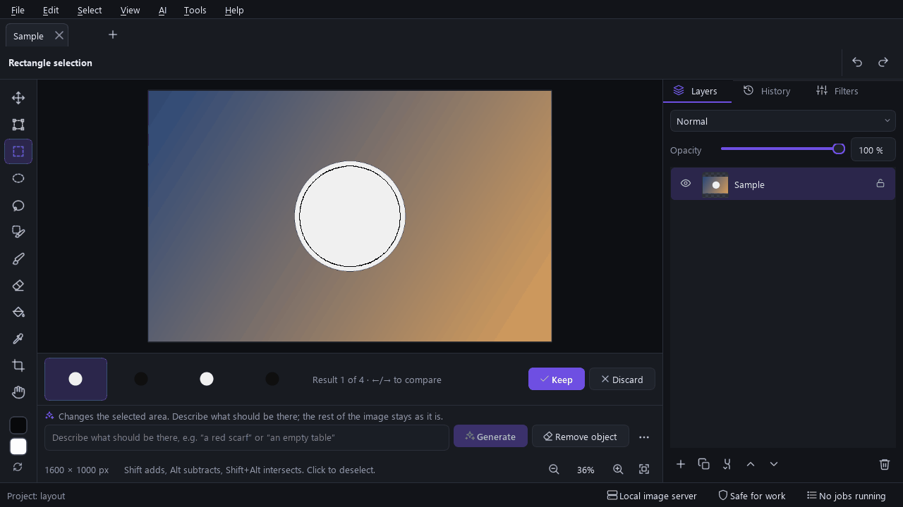

# Lumen Studio

Lumen Studio is a desktop image editor that changes pictures from what you describe. Open a picture,
select an area and say what should change, or start a new picture from a description; the AI runs
on your own computer or through an online service.



## What it does

* **An editor first.** It opens on a canvas, with layers, history, selection tools (rectangle,
  ellipse, lasso, a selection brush), brush, fill, crop and free transform. Pictures open and save
  like in other editors (PNG, JPEG, WebP, TIFF, BMP, layered PSD).
* **Describe a change.** Select an area and type what should change: "colorize it, keep everything
  else", "remove the lamp", "replace the cup with a candle". Pixels outside the selection stay
  exactly as they were. With nothing selected the words change the whole picture, such as
  colorizing a black-and-white photo. *Remove object* fills an area from its surroundings.
* **Pick a result.** Each run makes 1 to 4 results; compare them on the canvas and keep one as a new
  layer, so the original stays underneath.
* **New images** from a description (*New from prompt*), or on a blank canvas.
* **Filters**: built-in ones (black and white, old photo, film grain…), filters with AI steps
  (colorize, clean up or remove the background, upscale), and your own, built in a node editor.
* **Easy setup.** *Set up AI* offers three ways: run a model on this computer (it suggests one for
  your graphics card and downloads only what it does not find), use an online service (fal.ai,
  OpenAI, Google Gemini), or connect a server you already run (ComfyUI, Forge / WebUI,
  stable-diffusion.cpp). Model presets know what each model family needs: choosing FLUX.2 [klein],
  FLUX.1, Qwen-Image, SDXL or Anima fills in its VAE and text encoders.
* English and German, dark, light and high-contrast themes.

**Plugins**, optional and off by default (*Tools → Plugins…*), add character creation with an AI
director and an assistant, a pose editor, and Live2D part slicing.

## Quick start

1. Install with `LumenStudio-<version>-win64.exe`, or unzip the portable ZIP and run
   `LumenStudio.exe`.
2. At the first start, **Set up AI** asks where the AI should run. *Run on this computer* is free and
   private (FLUX.2 [klein] 4B on an 8 GB NVIDIA or AMD card); *Use an online service* needs a key.
3. Open a picture, select an area, describe the change and press Enter.

The **[user guide](docs/USER_GUIDE.md)** explains the editor, setup, filters, settings and shortcuts.
The plugins are described in **[docs/PLUGINS.md](docs/PLUGINS.md)**.

## Building from source (Windows, MinGW)

Requirements: Qt 6.9 (MinGW 64-bit kit, with the optional **Qt WebSockets** and **Qt Image
Formats** modules), MinGW-w64 13 (shipped with Qt), CMake 3.25 or newer, and Ninja.

```bash
# QT_ROOT must point at the Qt kit; MinGW, CMake and Ninja must be on PATH.
cmake --preset mingw-debug
cmake --build --preset mingw-debug
```

To keep machine-specific paths out of the repository, put them in a `CMakeUserPresets.json` (it is
git-ignored) with a preset that inherits `mingw-debug` and sets `QT_ROOT` and `PATH`.

After each build the Qt DLLs, plugins and the MinGW runtime are copied next to
`build/<preset>/bin/LumenStudio.exe` (windeployqt), so it starts without Qt on `PATH`; turn this off
with `-DLUMEN_DEPLOY_ON_BUILD=OFF`.

### Running the tests

```bash
export LUMEN_DATA_DIR=/path/to/a/folder/of/your/own   # the tests never touch your settings
scripts/run-tests.sh build/mingw-debug
```

The tests use mock servers and synthetic images; nothing runs on the GPU or downloads models.

The layout audit (`tst_layout`, and `tst_layout_150` at a 150 % scale factor) opens the main window,
its panels, every plugin window and every dialog at 1280 × 720, 1536 × 864 and 1920 × 1080. It is
strict: it fails on any control that is cut, squeezed, clipped or overlapping, and on a dialog that
does not fit a 1280 × 680 screen. `LUMEN_LAYOUT_REPORT=1` only reports; with `LUMEN_SCREENSHOT_DIR`
set it writes `layout/layout-report.md` (`layout-150/` at 150 %) and a PNG of every screen.

### Packaging and translations

`bash scripts/package.sh` makes what you ship: it checks the translations, builds a release, deploys
Qt and the MinGW runtime into `dist/LumenStudio-<version>-win64/`, checks that every DLL is there,
starts the packaged program without Qt on PATH, and writes the NSIS installer, the portable ZIP and
their SHA-256 checksums. The installer needs NSIS (`winget install NSIS.NSIS`); `--no-installer`
skips it. `scripts/package.ps1` does the same in PowerShell, without Git Bash
(`powershell -ExecutionPolicy Bypass -File scripts\package.ps1`, `-NoInstaller` to skip the
installer). The version is `project(VERSION …)` in `CMakeLists.txt`. Nothing is signed; without a code
signing certificate, Windows SmartScreen warns about the download. `scripts/make-icon.py`
regenerates the application icon. What is shipped under which licence is in
[docs/THIRD_PARTY_NOTICES.md](docs/THIRD_PARTY_NOTICES.md).

`python scripts/update-translations.py [build/<dir>]` refreshes `translations/*.ts` from the
sources (the `update_translations` target, then it puts the locations and layout of
`lumen_en.ts`, which Qt's tooling writes from a copy in the build tree, back as they were). Edit
them with Qt Linguist, then run `python scripts/check-translations.py`, which reports unfinished
entries and broken placeholders, tags or accelerators. Prompts sent to AI models are kept out of
`tr()` on purpose. `LUMEN_LAYOUT_TRANSLATION=build/<dir>/src/app/lumen_de.qm` runs the layout audit
(`tst_layout`, `tst_layout_150`) in German, whose longer texts find layouts the English ones fit.

## Project layout

| Path | Contents |
|---|---|
| `src/core` | logging, settings, secrets, jobs, async helpers, image operations, PSD, JSON schema |
| `src/net` | HTTP client (retry, streaming, multipart), SSE parser |
| `src/doc` | projects (SQLite), assets, layered documents, image files, undo |
| `src/filters` | node filter graphs: graph model, `.lumenfilter` files, evaluation with a result cache, classic image nodes |
| `src/ai` | provider framework and adapters, the generation service, the filters' AI nodes, director pipeline, part slicing |
| `src/runtime` | local servers: hardware detection, runtime installs, the models folder, model presets, downloads, the server supervisor, the setup plan, LoRA training |
| `src/pose` | OpenPose skeleton, renderer, FK/IK editing, 3D rig, presets |
| `src/live2d` | Cubism Core binding, motion, expression and pose playback, physics, software renderer |
| `src/ui` | the core application: main window, start screen, canvas and tools, prompt bar, panels, dialogs, the extension interface (`ui/ext/Extension.h`) |
| `src/plugins` | the Characters, Poses and Live2D parts plugins; the core (`src/ui` and below) never includes them |
| `src/app` | the executable's entry point |
| `resources` | model presets, built-in filters, runtime catalog, ComfyUI workflow templates |
| `tests` | unit, contract and layout tests (mock HTTP server) |
| `tools/partserver` | reference Lumen Part Server (see-through sidecar) |
| `docs` | [user guide](docs/USER_GUIDE.md), [plugins](docs/PLUGINS.md), [development plan](docs/DEVELOPMENT_PLAN.md) (architecture and roadmap) |
